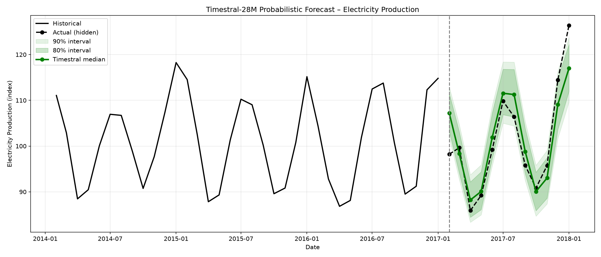
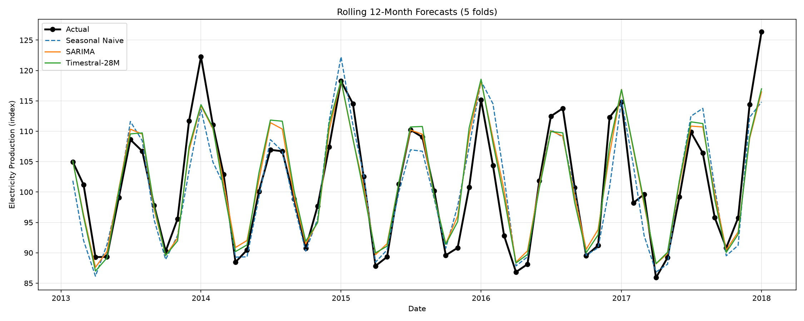

# Zero-shot forecasting with Mistral's Timestral vs classical baselines

Can a 28M-parameter time-series foundation model, used **zero-shot** (no training on this data), keep up with a fitted SARIMA model on a strongly seasonal monthly series?

This notebook puts [Mistral's Timestral-28M](https://huggingface.co/mistralai/Timestral-28M) up against two classical baselines on 33 years of US electricity production data, using a single hold-out year and a 5-fold rolling-origin backtest.



## Models

| Model | Training on this series | Output |
|---|---|---|
| Seasonal naive | None (repeats last 12 months) | Point |
| SARIMA(1,1,1)(1,1,1,12) | Fitted per fold | Point |
| Timestral-28M | **None (zero-shot)** | 21 quantiles |

## Evaluation

- **Hold-out:** last 12 months hidden from every model.
- **Rolling-origin backtest:** 5 folds, expanding training window, 12-month horizon. Each of the final 5 years is a test window, and SARIMA is refitted for each fold.
- **Metrics:** MAE, RMSE, MAPE (mean and std across folds).
- **Uncertainty:** 80% and 90% prediction intervals from Timestral's quantiles, with empirical coverage on the hold-out year.

## Results

Rolling backtest, 5 folds (lower is better):

| Model | MAE (mean) | MAE (std) | RMSE (mean) | RMSE (std) | MAPE % (mean) | MAPE % (std) |
|---|---|---|---|---|---|---|
| SARIMA | 2.749 | 0.637 | 3.536 | 0.847 | 2.671 | 0.592 |
| Timestral-28M | 2.794 | 0.537 | 3.551 | 0.722 | 2.708 | 0.503 |
| Seasonal Naive | 3.274 | 0.934 | 4.327 | 1.244 | 3.147 | 0.886 |

Single 12-month hold-out (Feb 2017 – Jan 2018):

| Model | MAE | RMSE | MAPE % |
|---|---|---|---|
| SARIMA | 3.589 | 4.657 | 3.408 |
| Timestral-28M | 3.662 | 4.623 | 3.489 |
| Seasonal Naive | 4.342 | 5.320 | 4.145 |



**Key findings**

- Zero-shot Timestral-28M is effectively tied with a fitted SARIMA: 2.71% vs 2.67% mean MAPE across 5 folds, a gap well inside the fold-to-fold spread. Both beat seasonal naive by roughly 15%.
- Timestral was the most stable model, with the lowest standard deviation on every metric across folds.
- On the hold-out year, 10 of 12 actuals fell inside both the 80% and 90% intervals (83%), so the 90% band runs slightly narrow. Both misses are at the edges: Feb 2017, which came in well below forecast, and the sharp Jan 2018 peak, which all three models underestimate.

## Run it yourself

```bash
git clone https://github.com/jaslabana/experiments.git
cd experiments/timestral-electricity-forecasting

python -m venv .venv
source .venv/bin/activate          # Windows: .venv\Scripts\activate
pip install -r requirements.txt

jupyter lab timestral_electricity_forecasting.ipynb
```

Then fetch the dataset into `data/` (see [data/README.md](data/README.md) for details):

```bash
python scripts/download_data.py
```

Use Python 3.10–3.12; very new Python releases may not have PyTorch wheels yet.

The first run downloads the Timestral-28M weights from Hugging Face. Inference runs fine on CPU.

## Repository layout

```
├── timestral_electricity_forecasting.ipynb   # the analysis
├── data/Electric_Production.csv              # monthly series, 1985–2018
├── figures/                                  # charts saved by the notebook
├── results/                                  # metrics saved by the notebook
├── scripts/download_data.py                  # re-fetch the dataset
└── requirements.txt
```

## Data

US industrial production index for electric and gas utilities, monthly, January 1985 to January 2018 (397 observations).

- Downloaded from Kaggle: [Time Series Datasets (shenba)](https://www.kaggle.com/datasets/shenba/time-series-datasets?select=Electric_Production.csv)
- Original source: Board of Governors of the Federal Reserve System, series [IPG2211A2N](https://fred.stlouisfed.org/series/IPG2211A2N), retrieved via FRED.

## Limitations

- One series and one horizon. This is a sanity check, not a benchmark.
- SARIMA orders are fixed, not tuned per fold, which slightly handicaps it.
- Foundation models tend to pay off most when you have many series and no time to tune each one, which this setup doesn't test.

## Licence

Code: MIT (see [LICENSE](LICENSE)). The Timestral model weights are covered by Mistral's own licence, so check the [model card](https://huggingface.co/mistralai/Timestral-28M) before any commercial use.
